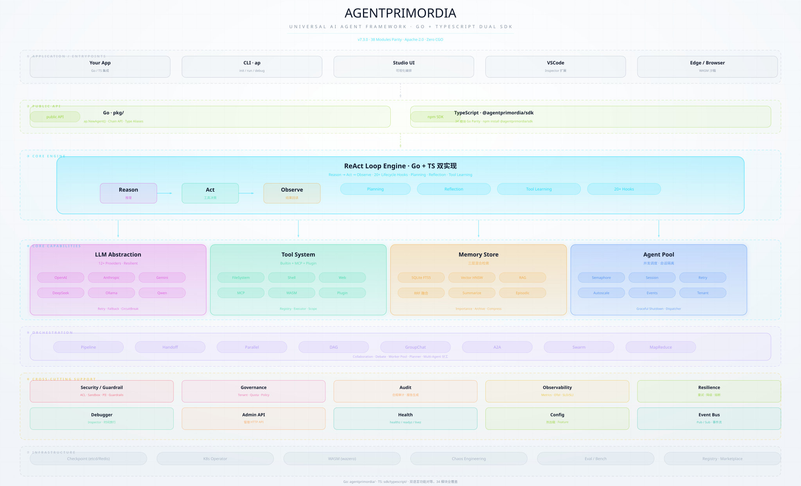

# AgentPrimordia

**Build AI agents in Go — compiled, concurrent-native, single binary, zero CGO**

[](LICENSE)
[](https://golang.org)
<a href="https://github.com/Gleamseekers/AgentPrimordia/releases"></a>
<a href="https://github.com/Gleamseekers/AgentPrimordia/actions/workflows/ci.yml"></a>

<p align="center">
  
  <br>
  <sub>Interactive architecture diagram (zoom / theme switch / guided views):
  <a href="agentprimordia/docs/ap-architecture-v7.3.html">ap-architecture-v7.3.html</a></sub>
</p>

```bash
# Install the CLI straight from the module proxy — no clone, no replace directive
go install github.com/Gleamseekers/AgentPrimordia/v7/agentprimordia/cmd/ap@latest

# Scaffold and run your first agent — no API key required
ap init my-agent --template quickstart
cd my-agent
go mod tidy
go run .
```

**About a minute. Zero config. No API key.** The agent is already running: with
`AP_LLM_API_KEY` unset the scaffolded project runs in Demo mode, so the full ReAct loop is
real and only the model is simulated.

中文说明见 [README.zh-CN.md](README.zh-CN.md)。

---

## Why AgentPrimordia

| | AgentPrimordia | Other frameworks |
|---|---|---|
| **Getting started** | `go install` + `ap init`, then `go run .` — no key needed for the first run | install deps, configure keys, write boilerplate |
| **Language** | Go — compiled, concurrent-native, single binary | Python — runtime dependency churn |
| **Deployment** | Single binary + SQLite, zero infrastructure | Docker + Redis + Postgres + … |
| **Interop** | A2A protocol native, with a self-check (`ap a2a interop-check`) | bespoke integrations |
| **Evidence** | Claims are measured and published; gates are pre-registered | marketing tables |

## Core capabilities

- **ReAct engine** — reasoning + acting loop with per-turn checkpoints, crash resume, streaming, context trimming, and 30+ lifecycle hooks
- **Learning loop you can inspect** — tool success rates and task outcomes are recorded and surfaced (`ap profile`, `ap profile history`); skills learned are persisted and injected back into the loop. Capability *gains* are measured per capability, never promised wholesale
- **Orchestration** — Pipeline / Handoff / DAG / GroupChat / Debate / MapReduce, plus a Pool scheduler with bounded concurrency, session isolation and autoscaling
- **Tool system** — filesystem / shell / web / api / database / code-execution built-ins with scope validation, MCP integration, signed plugin marketplace
- **Three-tier memory** — SQLite (FTS5) + vector store (HNSW) + RAG hybrid retrieval (RRF fusion)
- **10+ LLM providers** — OpenAI / Anthropic / Gemini / Ollama (local) / Azure / Qwen / GLM / DeepSeek / Mistral / Cohere, behind one interface with retry, fallback chain and circuit breaker
- **A2A protocol** — agent discovery, task delegation and result return as a standard protocol (`ap a2a interop-check`)
- **Security** — ACL / sandbox / guardrails (injection, PII, topic) / path-traversal and symlink-escape protection; agent-generated code executes only inside a signed WASM sandbox
- **Observability** — Prometheus metrics, OpenTelemetry OTLP export, 35 structured error codes, Grafana-ready dashboards
- **Kubernetes Operator** — `AgentDeployment` CRD with declarative rollout and HPA autoscaling

## Quick start

### Install

```bash
# From the module proxy (recommended — the framework is a normal Go module)
go install github.com/Gleamseekers/AgentPrimordia/v7/agentprimordia/cmd/ap@latest

# Or build from a source checkout, at the repository root
go build -o ap ./agentprimordia/cmd/ap/
```

### First run in about a minute (no API key)

```bash
ap init my-agent --template quickstart
cd my-agent
go mod tidy
go run .          # or: ap run  (build + hot reload)
```

That is the whole path. `ap init` writes `main.go`, `.ap.yaml`, `go.mod` and `.gitignore`;
`go run .` builds and executes. Without `AP_LLM_API_KEY` you get Demo mode — a
keyword-matching provider that exercises the real loop before you spend a token.

`ap start my-agent` is a one-command variant that also resolves dependencies, but it
currently requires a framework source checkout to be reachable (in-repo, or via `AP_ROOT`);
from a clean machine use the `ap init` path above.

### Configure a real LLM

```bash
ap config set api-key sk-xxx
ap config set provider openai
ap config set model gpt-4o
go run .           # this time with a real model
```

Environment variables win over `.ap.yaml`: `AP_LLM_API_KEY`, `AP_LLM_BASE_URL`,
`AP_LLM_MODEL`. Any OpenAI-compatible endpoint works.

### Inspect what the agent learned

```bash
ap profile                 # capability profile: success rates, strengths, weak areas
ap profile history         # growth events over time
```

```
Agent Growth Profile
====================

Overall: 78% success (14/18 tasks), avg 4.2 turns

Top Capabilities:
  1. code-review     92% (23/25)  improving ↑
  2. data-analysis   85% (17/20)  stable →

Weak Areas:
  1. sql-migration   45% (5/11)   declining ↓
```

*(sample output — numbers are illustrative)*

### Learning dashboard

Studio is a separate binary in the framework module; it binds to `:8090` by default and
serves the learning dashboard at `/dashboard/learning`:

```bash
# from the repository root
go run ./agentprimordia/cmd/studio          # real engines by default
go run ./agentprimordia/cmd/studio -demo    # built-in demo data
# open http://localhost:8090/dashboard/learning
```

Capability radar, growth curves and per-domain detail — what the agent recorded, visible.

## Code examples

### Minimal agent

```go
provider, err := ap.NewOpenAIProvider(ap.Config{APIKey: os.Getenv("AP_LLM_API_KEY"), Model: "gpt-4o-mini"})
if err != nil {
    log.Fatal(err)
}

agent, err := ap.NewAgent("HelloAgent", "You are a helpful assistant.", provider, ap.WithMaxTurns(10))
if err != nil {
    log.Fatal(err)
}

resp, err := agent.Run(ctx, ap.UserMessage("hello"))
if err != nil {
    log.Fatal(err)
}
fmt.Println(resp.Content)
```

### Agent with tools + memory

```go
registry, err := ap.DefaultToolkit(ap.ToolkitConfig{RootDir: ".", EnableFS: true, EnableShell: true})
if err != nil {
    log.Fatal(err)
}
memory, err := ap.WithInMemory()
if err != nil {
    log.Fatal(err)
}
defer memory.Close()

agent, err := ap.NewAgent("CodingAssistant", "", provider,
    ap.WithMaxTurns(20),
    ap.WithToolkit(registry),
    ap.WithMemory(memory),
)
if err != nil {
    log.Fatal(err)
}

resp, err := agent.Run(ctx, ap.UserMessage("Review main.go for bugs"))
if err != nil {
    log.Fatal(err)
}
fmt.Println(resp.Content)
```

### Concurrent multi-agent scheduling

```go
pool := ap.NewPool(ap.PoolConfig{MaxConcurrency: 5})
defer pool.Close()
pool.SetModel(provider)

results, err := pool.Dispatch(ctx, []ap.TaskConfig{
    {ID: "task-1", Title: "Code analysis", Prompt: "Analyze main.go"},
    {ID: "task-2", Title: "Run tests", Prompt: "Run go test"},
})
if err != nil {
    log.Fatal(err)
}
for _, r := range results {
    fmt.Println(r.TaskID, r.Status, r.Duration)
}
```

### DAG orchestration

```go
dag, err := ap.NewDAGBuilder("pipeline").
    Node("collect", func(ctx context.Context, in string) (string, error) { return "raw: " + in, nil }).
    Node("analyze", func(ctx context.Context, in string) (string, error) { return "analyzed: " + in, nil }).
    Node("report", func(ctx context.Context, in string) (string, error) { return "report: " + in, nil }).
    Edge("collect", "analyze").
    Edge("analyze", "report").
    Build()
if err != nil {
    log.Fatal(err)
}

result, err := dag.Run(ctx, "sales data")
if err != nil {
    log.Fatal(err)
}
fmt.Println(result.Succeeded, "/", result.TotalNodes, "nodes")
```

### A2A interop

```go
// Delegate a task to a peer agent over the A2A protocol
client := ap.NewOpenInteropClient("https://peer.example.com")

task, err := client.SendTask(ctx, ap.OpenMessage{
    Role:  "user",
    Parts: []ap.OpenPart{{Type: "text", Text: "Summarize this repository"}},
})
if err != nil {
    log.Fatal(err)
}
fmt.Println(task.ID)
```

To *serve* delegated tasks, wrap an `ap.TaskExecutor` (`Execute` / `Cancel`) and register it:
`ap.NewOpenInteropServer(card, cfg).WithExecutor(myExecutor)`.

Every snippet above was compiled **and executed** against the published module (v7.5.1),
in Demo mode where no API key is set.

## Architecture

```
┌─────────────────────────────────────────────────────┐
│                  Your Application                    │
├─────────────────────────────────────────────────────┤
│              AgentPrimordia Framework                │
│                                                      │
│  ┌──────────┐ ┌──────────┐ ┌────────┐ ┌─────────┐  │
│  │ ReActLoop│ │   Pool   │ │  DAG   │ │Pipeline │  │
│  └────┬─────┘ └────┬─────┘ └───┬────┘ └────┬────┘  │
│       └────────────┼───────────┼───────────┘        │
│              ┌─────┴─────┐                           │
│              │Tool System│                           │
│              │Built-in + MCP + Plugin                │
│              └───────────┘                           │
│                                                      │
│  ┌──────────┐ ┌──────────┐ ┌────────┐ ┌──────────┐  │
│  │ Memory   │ │ Learning │ │ Metrics│ │Guardrails│  │
│  │SQLite+FTS│ │SelfModel │ │OTel/   │ │ACL/Sandbox│ │
│  │+Vector   │ │+GrowthLog│ │Prom    │ │+PII      │  │
│  │+RAG      │ │+Studio   │ │        │ │          │  │
│  └──────────┘ └──────────┘ └────────┘ └──────────┘  │
└─────────────────────────────────────────────────────┘
```

## Project structure

```
AgentPrimordia/
├── agentprimordia/          # core framework module
│   ├── cmd/ap/              # the CLI
│   ├── internal/            # 30+ internal packages
│   │   ├── agent/           # ReAct engine + microkernel (30+ sub-packages)
│   │   ├── pool/            # multi-agent scheduling
│   │   ├── tools/           # tool system
│   │   ├── memory/          # memory store + SelfModel + GrowthLog
│   │   ├── llm/             # 10+ LLM providers
│   │   ├── studio/          # Studio engine + learning dashboard
│   │   └── ...              # full list: internal/AGENTS.md
│   ├── pkg/                 # public API
│   ├── operator/            # Kubernetes Operator (separate Go module)
│   ├── bench/               # benchmarks and eval suites
│   └── ecosystem/           # examples + plugins + templates
├── pgvector/                # pgvector vector-store extension
├── gateway/                 # gateway
├── wasm/                    # WASM sandbox (wazero)
└── sdk/typescript/          # TypeScript SDK (feature parity with Go)
```

## CLI commands

```bash
ap start my-agent              # create + install deps + run (needs a framework checkout)
ap init my-agent               # scaffold a project (manual mode)
ap run                         # build and run the current project (--watch hot reload)
ap profile                     # agent growth report
ap profile history             # growth event history
ap config set api-key sk-xxx   # configure the API key
ap debug                       # debug server
ap loop trace                  # execution trace
ap test                        # eval test suite
ap mcp list / add / test       # MCP server management
ap plugin install <url>        # install a plugin (signature verified)
ap marketplace install <url>   # install an agent template (signature verified)
ap cluster init / join / status / leave / scale
ap autonomy run / list / resume / status
ap skill list / add / remove / verify
ap a2a interop-check           # A2A protocol self-check
ap doctor                      # health check
ap completion                  # shell completion scripts
```

## Examples

| Example | What it shows | Run |
|---|---|---|
| code-review-agent | code review agent with a learning loop | `go run ./agentprimordia/ecosystem/examples/code-review-agent/` |
| data-analysis-agent | data analysis agent | `go run ./agentprimordia/ecosystem/examples/data-analysis-agent/` |
| a2a-handoff | **cross-process A2A handoff: two processes, zero credentials** | `./agentprimordia/ecosystem/examples/a2a-handoff/run.sh` |
| a2a-connect | A2A protocol interop | `go run ./agentprimordia/ecosystem/examples/a2a-connect/` |
| github-issue-triage | automatic GitHub issue triage | `go run ./agentprimordia/ecosystem/examples/github-issue-triage/` |
| multi-agent | Pool concurrent scheduling | `go run ./agentprimordia/ecosystem/examples/multi-agent/` |
| chain-api | minimal chain API | `go run ./agentprimordia/ecosystem/examples/chain-api/` |

Run examples from a source checkout at the repository root.

## Design philosophy

1. **Born in production** — the core patterns were extracted from a production agent system, not invented for a demo
2. **Interfaces first** — LLM / tools / memory are all behind interfaces, freely replaceable
3. **Zero-config start** — `ap init` + `go run .` needs no configuration to run
4. **Measured, not promised** — capability claims carry evidence anchors; the ones that failed their gates are documented as failures
5. **Minimal dependencies** — the core is CGO-free (SQLite + YAML only); gRPC / Redis / etcd / wazero are opt-in
6. **TDD enforced** — Red → Green → Refactor, with a CI gate on coverage tiers, deprecation residue and API contract drift

## Tech stack

- **Go 1.26+** — compiled, concurrent-native, single-binary deployment
- **SQLite** — embedded memory store (`modernc.org/sqlite`, pure Go, zero CGO)
- **gRPC** — A2A protocol transport
- **wazero** — WASM sandbox execution (pure Go, zero CGO)
- **OpenTelemetry** — observability standard

## What we deliberately do not claim

Honesty is part of the API surface. Three capabilities are intentionally kept off the
headline table:

- **The world model is opt-in.** `ap.WithWorldModel()` stays off by default: the
  pre-registered experiment ran 112 pairs, A 89/112 vs B 95/112 (+5.4pp, McNemar p=0.1796),
  and the gate (+15pp and p<0.05) was not met — flipping the default was formally rejected.
  Registry: [docs/降级豁免登记-V7弧线.md](docs/降级豁免登记-V7弧线.md) (E-1).
- **`EnhancedPlanner` is not a selling point.** Its recursive decomposition measured
  **−47.8pp (p=0.001)** on short-horizon ReAct tasks
  ([docs/v7.2-验收实验报告.md](docs/v7.2-验收实验报告.md)); it ships as `Experimental` behind
  planning-budget guardrails.
- **Agent-authored tools are research-blocked.** The sandbox half is real — agent-generated
  artifacts execute only inside the signature-verified WASM sandbox and the host never
  compiles or loads agent code — but the generator has no production implementation.

What we do claim: one provider interface with resilient calling, a ReAct loop with
per-turn checkpoints and resume, three-tier memory, pool scheduling, sandbox/ACL, A2A
protocol interop, and a reproducible evaluation culture (pre-registered gates, quarterly
bootstrap comparisons, published reports).

## Documentation

- **[Doc authority index](docs/文档权威索引.md)** — the single entry point for "which of 260+ documents do I trust" (version truth / current facts / plans / history)
- **[Experimental capability registry](docs/实验性能力清单.md)** — which capabilities are really wired, which are demo-only or shells
- **[English front door](agentprimordia/README.md)** · [English getting started](agentprimordia/docs/getting-started/five-minutes.md) · [English handbook](agentprimordia/docs/AP-开发手册-EN.md)
- [v7.5 release notes](agentprimordia/docs/CHANGELOG-v7.5.md) · [Three-track user guide](agentprimordia/docs/三战线用户指南.md) · [Demo video script](agentprimordia/docs/demo-video-script.md)
- [Architecture](docs/架构图.md) · [API reference](docs/API参考.md) · [Version policy](agentprimordia/docs/版本规范.md)
- [TypeScript SDK](sdk/typescript/README.md) · [Getting started](agentprimordia/ecosystem/docs/getting-started.md) · [CLI guide](agentprimordia/ecosystem/docs/ap-guide.md) · [Best practices](agentprimordia/ecosystem/docs/best-practices.md) · [Cookbook](agentprimordia/ecosystem/docs/cookbook/)
- [Internal module map](agentprimordia/internal/AGENTS.md) · [Full changelog](docs/CHANGELOG.md)

## Version history

| Version | Theme | Highlights |
|---|---|---|
| **v7.5.1** | Release pipeline fix | 6-platform binaries + checksums + cosign signatures + SBOM; `go install …@latest` works end to end |
| v7.5 | Security & quality campaign | shell allowlist hardened against 7 verified attack chains, `jsonutil` concurrency corruption fixed, 167 disabled tests restored; module path moved to `/v7` so the framework is distributable via `GOPROXY` |
| v7.4 | Wiring batch | OTel end-to-end export, Studio on real engines, signed template registry, tool-learner auto-assembly, skill library into the loop, autonomy CLI real execution |
| v7.3 | Three tracks | zero-barrier entry, visible learning loop, A2A ecosystem interop |
| v7.2 | A/B acceptance | full acceptance experiments (P2 EnhancedPlanner came out significantly negative — see above) |
| v7.0–7.1 | Five components | distillation, gap tools, resident runtime, federation; world model shipped opt-in |
| v6.0 | Consolidation | 39 modules frozen, cognitive engine + self-evolution loop |
| v5.0 | Balance | real wiring + multimodal + distributed + platform |
| v4.0 | Stability | contract lock + performance + compatibility tightening |
| v1–3 | Incubation | core engine + microkernel + dual language + ecosystem |

Full history: [CHANGELOG](docs/CHANGELOG.md).

## License

Apache-2.0 © AgentPrimordia Contributors

---

<!--
  Machine-checked anchors for scripts/doc-version-consistency.mjs.
  These lines are deliberately not rendered: the gate's regexes are Chinese-phrased and
  numeric, so the visible English text above stays qualitative and non-rotting while the
  gate still forces an update whenever the measured numbers move.
  Update together with the code, then re-run: node scripts/doc-version-consistency.mjs

  [](agentprimordia/docs/CHANGELOG-v7.5.md)
  [](agentprimordia/internal/)
  Red → Green → Refactor，663 个测试文件
  核心框架主模块（162 个包，1366 个 Go 文件）
  微内核（34 个子包）
-->
